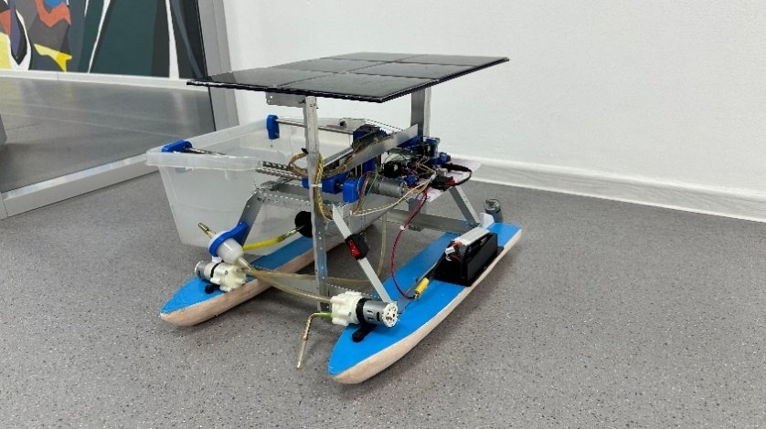
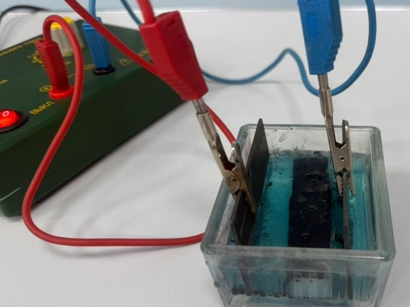
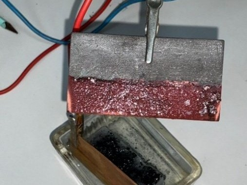
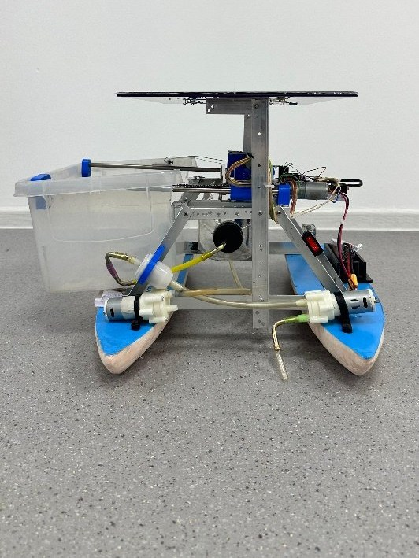
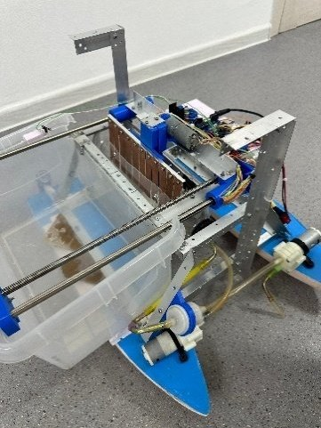

# Uranium Recovery

Extracting metal from water with a sorbent and electrolysis, on a small autonomous boat.
School research project, NIS Taldykorgan, 2026. Bronze medal at InfoMatrix Asia 2026.



&nbsp;

There is about a thousand times more uranium in the oceans than on land, but it is very diluted: about 3 micrograms per litre. Sorbents catch it well, but releasing it afterwards takes strong acid. Electrolysis needs no acid, but it uses a lot of energy.

We tried to combine the two. The sorbent is part of the electrode, so it captures the ions, and the current then releases them and cleans the sorbent. The whole module sits on a robot that can work at sea without a fixed station.

&nbsp;

## Experiment

We couldn't work with uranium at school, so we used copper ions (Cu²⁺) as a safe model. We used water from Alakol Lake and a CuSO₄ solution, a sorbent made of activated carbon and chitosan, and graphite electrodes.

<table>
  <tr>
    <td width="50%"></td>
    <td width="50%"></td>
  </tr>
  <tr>
    <td align="center"><sub>Electrodes and sorbent in the solution</sub></td>
    <td align="center"><sub>Copper on the cathode after 15 minutes</sub></td>
  </tr>
</table>

After 10 to 15 minutes, a pink layer of copper formed on the cathode and the sorbent turned dark. About 70–85% of the copper was recovered, and no acid was used at any step.

```
cathode   Cu²⁺ + 2e⁻ → Cu
anode     2H₂O → O₂ + 4H⁺ + 4e⁻
```

&nbsp;

## Robot

A catamaran with a solar panel, pumps and the sorbent–electrode module. It takes in water, processes it and stores the metal in a sealed container.

<table>
  <tr>
    <td width="50%"></td>
    <td width="50%"></td>
  </tr>
</table>

&nbsp;

## Limits

Copper is not uranium, and a school lab is not the sea. The results show that the idea works in principle, nothing more. The robot is a model and hasn't been tested on open water.

&nbsp;

---

Paper: [Uranium_Recovery_paper.pdf](paper/Uranium_Recovery_paper.pdf)<br>
Authors: Shakhnur Oralbek, Saltanat Tolegen<br>
Supervisor: Nikolay Avdyunin<br>
Supported by an internal grant from AUES, Almaty
